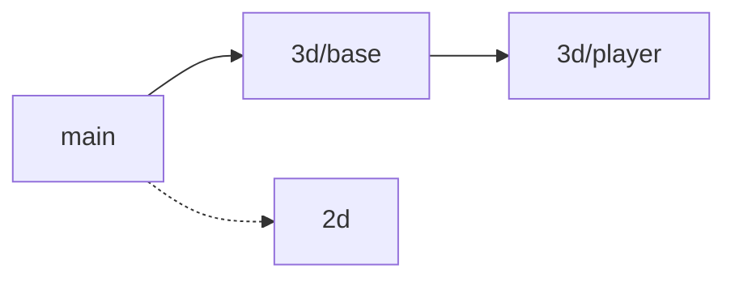

# bevy-starter

A starter template for building games with [Rust](https://www.rust-lang.org/) and [Bevy](https://bevy.org/) 0.20.

## Features

- Splash screen with the Bevy logo, then every logo in `assets/splash/logos/`, each one skippable
- Main menu with background art, buttons and looping music that fades with the screen:
  New Game, Continue (only when a save can be loaded), Load Game, Settings, Credits, Quit
- Credits and Settings overlays over the running screen: fullscreen toggle, volume slider
  and language, remembered between runs
- English, Brazilian Portuguese and Japanese, switched live from Settings, following the OS
  language on the first run; translations in `assets/locales/`, drawn in Noto Sans JP
- Loading screen with a progress bar over the real asset load and a shuffled slideshow
- Intro that plays a frame sequence with its soundtrack, skippable with keyboard or mouse
- Pause menu on Esc that freezes game time: Resume, Save, Load Game, Settings, Quit to Menu,
  Quit to Desktop, asking "Quit without saving?" when there is unsaved play time
- Saved games, one file each in the per-user data folder: name a new save or overwrite an
  older one from the pause menu, and load or delete any of them from the menu or the pause
  menu, newest first, in a scrolling list
- Autosave after every 5 minutes of unsaved play, each one kept as its own file
- A dark, calm look in one palette: pill buttons that ease in an amber glow, glass panels that
  rise in over a real blur of the screen behind them
- Screen flow driven by Bevy states
- Fast dev builds: dynamic linking and optimized dependencies
- FPS overlay, shown and hidden with F3, and asset hot reloading in dev builds
- Fast linking on Windows with `rust-lld`
- Release packaging into a ready-to-ship `dist/` folder
- Third-party license notices generated on every release
- No console window on Windows release builds

## Branches

`main` holds the template itself, with nothing tied to one kind of game. The variants grow
from it as a tree of branches: a genre's base branch starts from `main`, and every other
branch starts from the one it builds on. Clone the branch closest to the game you are making.



Solid arrows are branches that exist, dashed ones are planned.

| Branch      | What it is for                                                                                            |
| ----------- | --------------------------------------------------------------------------------------------------------- |
| `main`      | The template for any game                                                                                 |
| `3d/base`   | A test level (`playroom.glb`) under a sky and a glaring sun                                               |
| `3d/player` | Physics, and a player walking the level, seen through cameras (planned, waiting on avian3d for Bevy 0.20) |

Each branch's `docs/specs/` holds the designs built on it and what is still to come.
The cameras planned for `3d/player` (first-person, third-person and isometric) will not be
branches of their own: a game will keep any of them, and switch between them with F5 when it
keeps more than one. Multiplayer is planned too, as an option across the kinds rather than a
branch. [`create-bevy-starter`](https://github.com/Heryk13/create-bevy-starter) builds a game
from `main` or `3d/base`: it clones the branch, renames the game and starts a fresh git
history. Its design is in [its spec](docs/specs/create-bevy-starter/design.md).

## Requirements

- Rust (latest stable) via [rustup](https://rustup.rs/)
- [just](https://github.com/casey/just)
- [cargo-about](https://github.com/EmbarkStudios/cargo-about), used by `just release`:
  `cargo install cargo-about --locked --features cli`
- **Windows:** `sh` on `PATH` (e.g. [Git for Windows](https://git-scm.com/)), used by `just` recipes
- **Linux:** Bevy's [system dependencies](https://github.com/bevyengine/bevy/blob/main/docs/linux_dependencies.md)

## Usage

| Command        | Description                                            |
| -------------- | ------------------------------------------------------ |
| `just run`     | Run the game in dev mode                               |
| `just fix`     | Apply clippy fixes and format the code                 |
| `just check`   | Check formatting and lints, and run the tests          |
| `just test`    | Run the tests only                                     |
| `just release` | Build an optimized release and package it into `dist/` |

- Turning this template into your own game: [docs/template.md](docs/template.md)
- Development loop and code conventions: [CONTRIBUTING.md](CONTRIBUTING.md)

## Cargo features

| Feature | Default | Description                                                                          |
| ------- | ------- | ------------------------------------------------------------------------------------ |
| `dev`   | yes     | Dynamic linking, FPS overlay, asset hot reloading and a console window on Windows    |

Release builds must disable it with `--no-default-features`, which `just release` already does.
A binary built with `dev` depends on the Bevy dynamic library and won't run on other machines.

## Releasing

```sh
just release
```

The `dist/` folder contains the executable, the `assets/` folder next to it
and `licenses.html` with the license notices of every dependency.
Zip it and ship it. The executable looks for `assets/` in its own directory.

The release fails if a dependency uses a license not listed in `about.toml`.
Review that license before adding it to the list.

Builds target the current OS only: build on each platform (Windows, Linux, macOS) to ship for it.

## License

The code is licensed under either of [MIT](LICENSE-MIT) or [Apache-2.0](LICENSE-APACHE), at
your option, like Bevy itself. The assets keep their own licenses, listed in
[`docs/template.md`](docs/template.md#assets).
