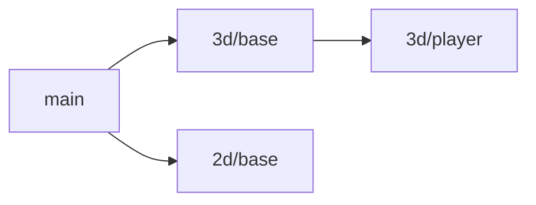

# bevy-starter

A starter template for building games with [Rust](https://www.rust-lang.org/) and [Bevy](https://bevy.org/) 0.20.

## Features

- Splash screen with the Bevy logo, then every logo in `assets/splash/logos/`, each one skippable
- Main menu with background art, buttons and looping music that fades with the screen:
  New Game, Continue (only when a save can be loaded), Load Game, Settings, Credits, Quit
- Credits and Settings overlays over the running screen: fullscreen toggle, Reduce
  Transparency (flat panels, no blur), volume slider and language, remembered between runs
- Key bindings: a feature registers its actions by name and never reads a key itself; the ones
  a player may change are listed on a Controls page in Settings, each rebound to another key or
  mouse button, remembered between runs
- English, Brazilian Portuguese and Japanese, switched live from Settings, following the OS
  language on the first run; translations in `assets/locales/`, drawn in Noto Sans JP
- Loading screen with a progress bar over the real asset load and a shuffled slideshow
- Intro that plays a frame sequence with its soundtrack, skippable with keyboard or mouse
- Pause menu on Esc that freezes game time: Resume, Save, Load Game, Settings, Quit to Menu,
  Quit to Desktop, asking "Quit without saving?" when there is unsaved play time
- Saved games, one file each in the per-user data folder: name a new save or overwrite an
  older one from the pause menu, and load or delete any of them from the menu or the pause
  menu, newest first, in a scrolling list, each beside a picture of the moment it was saved
- Autosave after every 5 minutes of unsaved play, each one kept as its own file
- A glass look in one palette: panels that rise in over a blur of everything behind them,
  other panels included, with a lit rim; capsule buttons that ease to white under the pointer,
  switches and a segmented control in Settings, a menu of plain words on a bar of light, and
  [Lucide](https://lucide.dev) icons by name
- Screen flow driven by Bevy states
- Fast dev builds: dynamic linking and optimized dependencies
- Dev tools in dev builds, each on a key you can change in Settings: a list of the dev keys
  (F1, waiting in the corner), the FPS overlay (F2), photo mode (F3: the game frozen with
  every dev window hidden, E saves a PNG of it into the data folder's `gallery/`), slow
  motion (F4, stepped with Numpad − and +) and the file explorer (Numpad 0: a drawer over
  the running game that browses the gallery and the game's `assets/` like the Windows
  explorer, with a preview, folders, renaming, dragging, a trash of its own, files dropped
  in from the OS, and a warning before changing an asset the code names); and asset hot
  reloading
- Fast linking on Windows with `rust-lld`
- Release packaging into a ready-to-ship `dist/` folder
- Third-party license notices generated on every release
- No console window on Windows release builds

## Branches

`main` holds the template itself, with nothing tied to one kind of game. The variants grow
from it as a tree of branches: a genre's base branch starts from `main`, and every other
branch starts from the one it builds on. Clone the branch closest to the game you are making.



| Branch      | What it is for                                                          |
| ----------- | ----------------------------------------------------------------------- |
| `main`      | The template for any game                                               |
| `3d/base`   | A test level (`playroom.glb`) under a sky and a glaring sun             |
| `3d/player` | Physics, a player in first person, and the 3D dev tools (F6, F7)        |
| `2d/base`   | A test room seen from above, drawn in tiles from an ASCII map           |

Each branch's `docs/specs/` holds the designs built on it and what is still to come.
The cameras of `3d/player` (first-person, built, then third-person and isometric) will not be
branches of their own: a game will keep any of them, and switch between them with F5 when it
keeps more than one. Multiplayer is planned too, as an option across the kinds rather than a
branch. [`create-bevy-starter`](https://github.com/Heryk13/create-bevy-starter) builds a game
from `main`, `3d/base`, `3d/player` or `2d/base`, the last three by its kind and, for a 3D
game, the camera picked: it clones the branch, renames the game and starts a fresh git
history. Its design is in [its spec](docs/specs/create-bevy-starter/design.md).

A change is committed on the highest branch that every game using it starts from, and merged
down from there. `tools/` does both in one command, and a game made by `create-bevy-starter`
does not get the folder:

| Command                                | Description                                                      |
| -------------------------------------- | ---------------------------------------------------------------- |
| `just tools/sync <branch> "<message>"` | Commit the working changes on that branch, then merge them down  |
| `just tools/down`                      | Merge every branch down the tree, committing nothing new         |
| `just tools/test`                      | Try the two on a throwaway repository                            |

Both check every branch they change with `just check`, stop at the first conflict or failed
check, and ask before pushing.

## Requirements

- Rust (latest stable) via [rustup](https://rustup.rs/)
- [just](https://github.com/casey/just)
- [cargo-about](https://github.com/EmbarkStudios/cargo-about), used by `just release`:
  `cargo install cargo-about --locked --features cli`
- **Windows:** `sh` on `PATH` (e.g. [Git for Windows](https://git-scm.com/)), used by `just` recipes
- **Linux:** Bevy's [system dependencies](https://github.com/bevyengine/bevy/blob/main/docs/linux_dependencies.md)

## Usage

| Command        | Description                                            |
| -------------- | ------------------------------------------------------ |
| `just run`     | Run the game in dev mode                               |
| `just fix`     | Apply clippy fixes and format the code                 |
| `just check`   | Check formatting and lints, and run the tests          |
| `just test`    | Run the tests only                                     |
| `just profile` | Run the game recording how long each system takes      |
| `just release` | Build an optimized release and package it into `dist/` |

`just profile` writes a dated file into `profiles/` when the game closes. To read it, open
[ui.perfetto.dev](https://ui.perfetto.dev) in any browser and drag the file in: it shows the
time every system took, frame by frame. Traced builds are slower than normal ones, so compare
systems with each other, and keep runs short, since the file grows fast.

- Turning this template into your own game: [docs/template.md](docs/template.md)
- Development loop and code conventions: [CONTRIBUTING.md](CONTRIBUTING.md)

## Cargo features

| Feature | Default | Description                                                                          |
| ------- | ------- | ------------------------------------------------------------------------------------ |
| `dev`   | yes     | Dynamic linking, the dev tools, asset hot reloading and a console window on Windows |

Release builds must disable it with `--no-default-features`, which `just release` already does.
A binary built with `dev` depends on the Bevy dynamic library and won't run on other machines.

## Releasing

```sh
just release
```

The `dist/` folder contains the executable, the `assets/` folder next to it
and `licenses.html` with the license notices of every dependency.
Zip it and ship it. The executable looks for `assets/` in its own directory.

The release fails if a dependency uses a license not listed in `about.toml`.
Review that license before adding it to the list.

Builds target the current OS only: build on each platform (Windows, Linux, macOS) to ship for it.

## License

The code is licensed under either of [MIT](LICENSE-MIT) or [Apache-2.0](LICENSE-APACHE), at
your option, like Bevy itself. The assets keep their own licenses, listed in
[`docs/template.md`](docs/template.md#assets).
